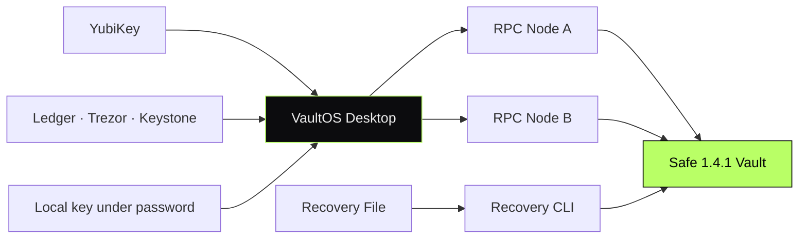

<div align="center">

```
   ██╗   ██╗ █████╗ ██╗   ██╗██╗     ████████╗
   ██║   ██║██╔══██╗██║   ██║██║     ╚══██╔══╝
   ██║   ██║███████║██║   ██║██║        ██║
   ╚██╗ ██╔╝██╔══██║██║   ██║██║        ██║
    ╚████╔╝ ██║  ██║╚██████╔╝███████╗   ██║
     ╚═══╝  ╚═╝  ╚═╝ ╚═════╝ ╚══════╝   ╚═╝
```

# VaultOS — Self-Custody Multisig for Mac

#### Two keys out of three move the money. One key cannot.
#### Audited Safe contracts, hardware keys, recovery without the app.

[](#)
[](#)
[](#)
[](#)

</div>

---

> **TL;DR** — A Mac app for holding funds under a multisig rule such as 2-of-3.
> Vaults run on externally audited Safe contracts, signing happens on hardware
> keys, and funds stay recoverable even if the app is gone.

---

## Overview

VaultOS creates and operates multisig vaults from a local desktop app. The first
release covers BNB Chain, Ethereum, Polygon, Arbitrum, Base and OP Mainnet, with
one vault living on one network.

Owners can be a YubiKey, Ledger, Trezor, Keystone, MetaMask, or a password-protected
key on the device. Co-owners on different devices link by code, and operations
and signatures travel between them automatically.

> This repository documents the system at the **architectural level**.
> Implementation code is private.

---

## My Role

> **Solo Engineer.** Product, protocol integration, desktop app and site.

- Desktop application and signing flows
- Core chain logic, keystore and recovery format
- On-chain infrastructure checks and contract verification
- Independent recovery tool that works without the app
- MCP server and CLI for AI agents
- Product site and license sales service

---

## Architecture



---

## System Components

| Component | Responsibility | Stack |
|---|---|---|
| **Desktop App** | Vault creation, signing, execution, history | Tauri · React · TypeScript |
| **Core** | Chain logic, keystore, recovery | TypeScript · `@noble` |
| **Contracts** | Multisig vaults and passkey signers | Safe 1.4.1 · Safe Passkey |
| **Recovery CLI** | Moves funds from a vault without the desktop app | TypeScript |
| **Agent MCP** | Local, read-mostly interface for AI agents | MCP · Node.js |
| **Sales Worker** | License sales for USDT (built, not yet deployed) | Cloudflare Workers |
| **Site** | Static product site with no trackers or cookies | Vite · GSAP |

---

## Capabilities

- **Any multisig rule** — 2-of-3 or any other threshold
- **Hardware signing** — YubiKey with mandatory touch, Ledger, Trezor, Keystone
- **Co-owners across devices** — link by code; operations and signatures sync
- **Readable contract calls** — plain words instead of ABI, with warnings on dangerous calls
- **Recovery without the app** — a recovery file and an independent tool

---

## Architectural Decisions & Tradeoffs

### 1. Only externally audited contracts in the first release

Vaults run on Safe 1.4.1 and YubiKey signing on Safe Passkey, both externally
audited. Our own delay and inheritance contracts are built but stay switched
off in 1.0, because they have no external audit yet.

### 2. Verify the deployed code, don't trust the address

The app compares each contract's runtime code hash with a pinned value. An RPC
error, missing code, substituted code or a disagreement between RPC nodes
blocks the check.

### 3. Every check against two different nodes

A single RPC node can be wrong or compromised. The app reads from two different
nodes, so one bad answer cannot pass as the truth.

### 4. Vault addresses bound to their network

New vaults are created with `createChainSpecificProxyWithNonce`, so an address
exists on one network only. The same vault cannot be claimed on another chain.

### 5. Recovery cannot depend on the product

If the app stops opening, a recovery file and a separate tool are enough to
collect signatures and move the funds.

### 6. An unknown outcome is a real state

If it is unclear whether a transfer went through, the app does not send it
again. The fee shown in advance is the fee that is charged.

---

## Engineering Invariants

- **Never** sign with a YubiKey without a physical touch
- **Never** count one device as two owners
- **Never** resend when a transfer's outcome is unknown
- **Never** trust a single RPC node
- **Never** report "no operations" until the history has been read in full

---

## Related Public Documents

- [`nullmask`](https://github.com/eldardzh/nullmask) — zero-knowledge privacy protocol
- [`multichain-wallet-stack`](https://github.com/eldardzh/multichain-wallet-stack) — self-custodial wallet patterns

---

<div align="center">

#### **Contact**
[**@EldarDissmay**](https://x.com/EldarDissmay) · **dissmay21@gmail.com**

<sub>© 2026 · Eldar D. · Built 2026.</sub>

</div>
